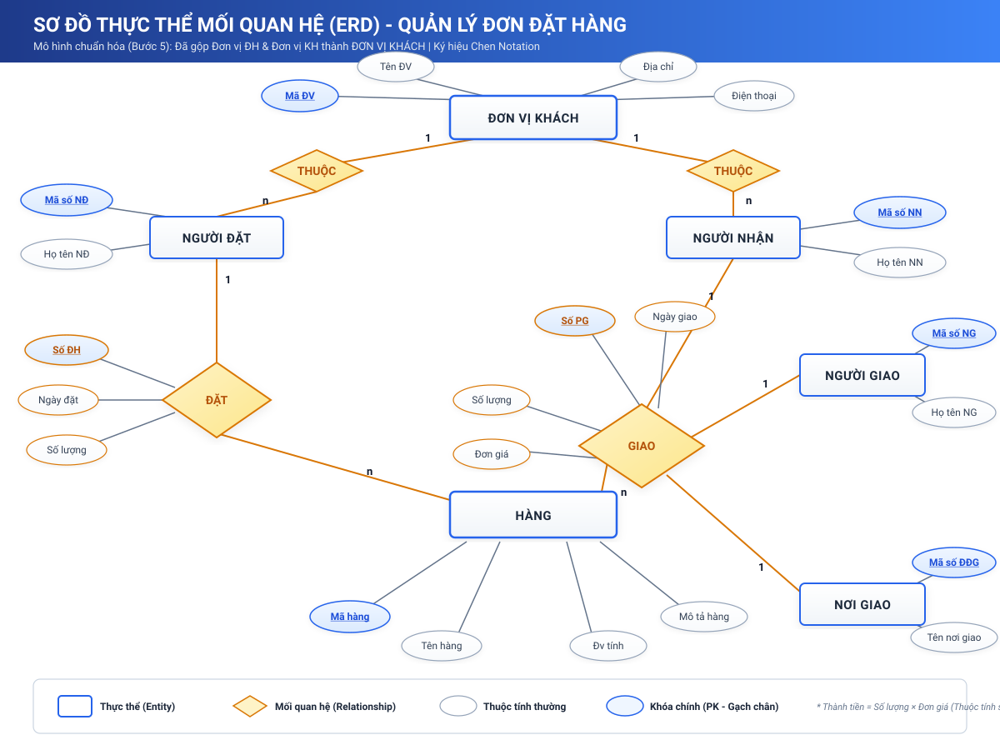
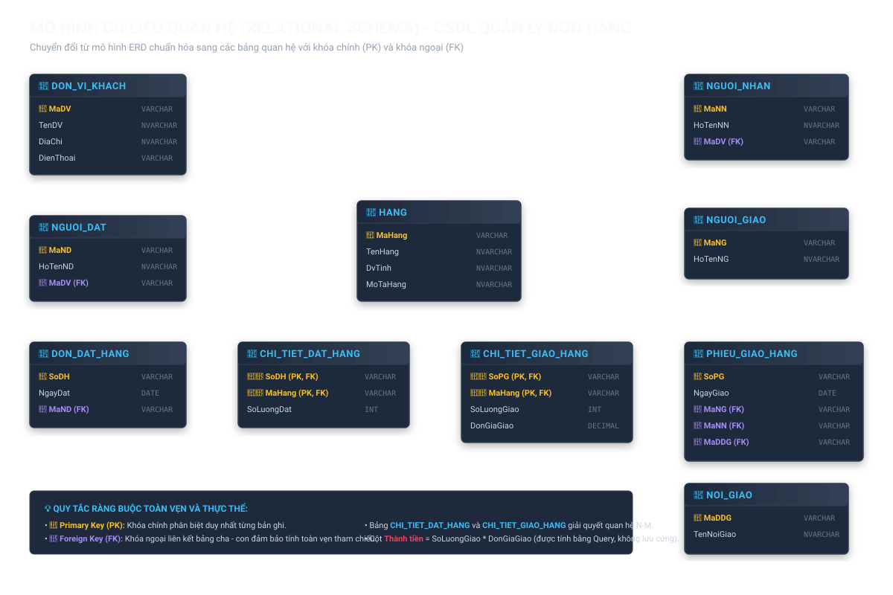
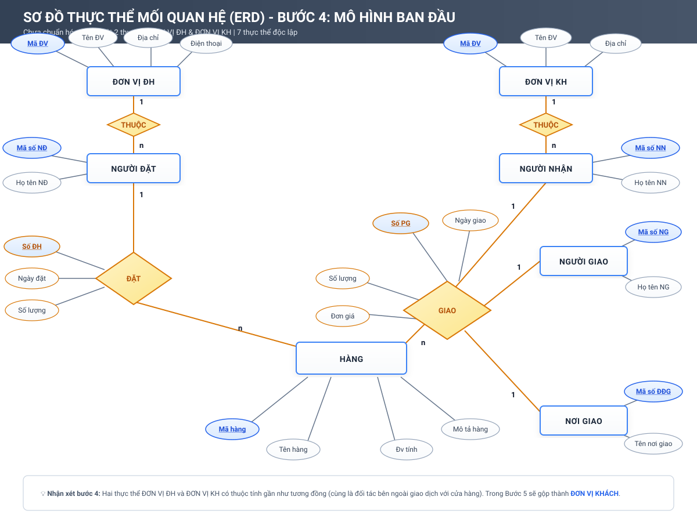
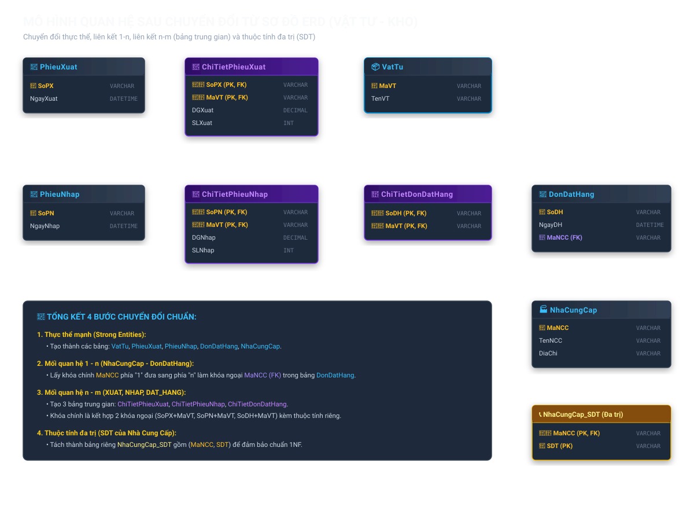

# [Thực Hành] Quản Lý Đơn Đặt Hàng - Xây Dựng Sơ Đồ ERD

Bài tập thực hành phân tích yêu cầu nghiệp vụ, xác định thực thể, thuộc tính, mối quan hệ và vẽ mô hình thực thể ERD (Entity Relationship Diagram) cho cơ sở dữ liệu Quản lý đơn đặt hàng.

---

## 📌 Mục Tiêu
- Biết cách phân tích và chọn lọc thông tin từ các biểu mẫu thực tế (Đơn đặt hàng, Phiếu giao hàng).
- Xác định đúng các thực thể, thuộc tính và khóa chính (Primary Key).
- Xác định các mối quan hệ (1-1, 1-N, N-M) và thuộc tính của mối quan hệ.
- Vẽ sơ đồ thực thể ERD theo chuẩn Chen Notation.
- Chuẩn hóa, rút gọn mô hình thực thể và chuyển đổi sang mô hình dữ liệu quan hệ (Relational Schema).

---

## 🖼️ SƠ ĐỒ ERD CHUẨN HÓA (BƯỚC 5)

> Mô hình đã được tối ưu hóa: Gộp **Đơn vị đặt hàng** và **Đơn vị khách hàng** thành **ĐƠN VỊ KHÁCH**.



---

## 🗄️ MÔ HÌNH BẢNG QUAN HỆ (RELATIONAL SCHEMA)

> Chuyển đổi mô hình ERD sang các bảng dữ liệu trong CSDL quan hệ với khóa chính (PK) và khóa ngoại (FK):



---

## 📊 SƠ ĐỒ ERD BAN ĐẦU (BƯỚC 4 - CHƯA GỘP)

> Mô hình gồm 7 thực thể trước khi thực hiện chuẩn hóa rút gọn:



---

## 📝 NỘI DUNG THỰC HIỆN CHI TIẾT THEO 5 BƯỚC

### Bước 1: Liệt kê, chọn lọc thông tin
Từ các phiếu nghiệp vụ:
1. **Đơn đặt hàng:**
   - Số đơn hàng (Số ĐH) - *Mã định danh đơn*
   - Tên đơn vị đặt hàng (Tên ĐV), Địa chỉ, Điện thoại
   - Ngày đặt
   - Tên hàng, Mô tả, Đơn vị tính (Đv tính)
   - Số lượng
   - Người đặt hàng (Họ tên NĐ)

2. **Phiếu giao hàng:**
   - Số phiếu giao hàng (Số PG) - *Mã định danh phiếu*
   - Tên đơn vị đặt hàng (Tên ĐV), Địa chỉ
   - Nơi giao hàng (Tên nơi GH)
   - Ngày giao
   - Tên hàng, Đơn vị tính (Đv tính)
   - Số lượng, Đơn giá
   - Thành tiền *(Thuộc tính suy diễn = Số lượng × Đơn giá, không lưu thô để tránh dư thừa dữ liệu)*
   - Tên người nhận (Họ tên NN)
   - Tên người giao (Họ tên NG)

---

### Bước 2: Xác định thực thể, thuộc tính và khóa chính

| Tên Thực Thể | Khóa Chính (PK) | Các Thuộc Tính Khác |
| :--- | :--- | :--- |
| **ĐƠN VỊ ĐH** | `Mã ĐV` | Tên ĐV, Địa chỉ, Điện thoại |
| **ĐƠN VỊ KH** | `Mã ĐV` | Tên ĐV, Địa chỉ |
| **HÀNG** | `Mã hàng` | Tên hàng, Đv tính, Mô tả hàng |
| **NGƯỜI ĐẶT** | `Mã số NĐ` | Họ tên NĐ |
| **NƠI GIAO** | `Mã số ĐĐG` | Tên nơi giao |
| **NGƯỜI NHẬN** | `Mã số NN` | Họ tên NN |
| **NGƯỜI GIAO** | `Mã số NG` | Họ tên NG |

---

### Bước 3: Xác định các mối quan hệ
- **Động từ chính:** `THUỘC`, `ĐẶT`, `GIAO`.
1. **Quan hệ THUỘC (Người đặt – Đơn vị ĐH):** Tỉ số `n : 1` (Một người đặt thuộc một đơn vị đặt hàng; một đơn vị có thể có nhiều người đặt).
2. **Quan hệ THUỘC (Người nhận – Đơn vị KH):** Tỉ số `n : 1` (Một người nhận thuộc một đơn vị khách hàng; một đơn vị có thể có nhiều người nhận).
3. **Quan hệ ĐẶT (Người đặt – Hàng):** Liên kết hình thành nên **Đơn đặt hàng**, thuộc tính quan hệ gồm: `Số ĐH`, `Ngày đặt`, `Số lượng`.
4. **Quan hệ GIAO (Người giao – Người nhận – Hàng – Nơi giao):** Liên kết bậc 4 hình thành nên **Phiếu giao hàng**, thuộc tính quan hệ gồm: `Số PG`, `Ngày giao`, `Số lượng`, `Đơn giá`.

---

### Bước 4: Vẽ biểu đồ mô hình thực thể ERD ban đầu
- Vẽ biểu đồ gồm 7 thực thể độc lập: `ĐƠN VỊ ĐH`, `ĐƠN VỊ KH`, `HÀNG`, `NGƯỜI ĐẶT`, `NƠI GIAO`, `NGƯỜI NHẬN`, `NGƯỜI GIAO`.
- *(Xem chi tiết tại file [erd_so_do_ban_dau.svg](erd_so_do_ban_dau.svg))*.

---

### Bước 5: Chuẩn hóa, rút gọn mô hình thực thể ERD
- **Lý do rút gọn:** `Đơn vị đặt hàng` và `Đơn vị khách hàng` đều là các đối tác bên ngoài giao dịch với cửa hàng và có các thuộc tính tương đồng (tên, địa chỉ, số điện thoại liên hệ).
- **Giải pháp:** Gộp thành một thực thể duy nhất là **ĐƠN VỊ KHÁCH** với các thuộc tính: `Mã ĐV` (PK), `Tên ĐV`, `Địa chỉ`, `Điện thoại`.
- **Cập nhật quan hệ:**
  - `NGƯỜI ĐẶT` **THUỘC** `ĐƠN VỊ KHÁCH` (n : 1)
  - `NGƯỜI NHẬN` **THUỘC** `ĐƠN VỊ KHÁCH` (n : 1)
- *(Xem chi tiết tại file [erd_so_do_chuan_hoa.svg](erd_so_do_chuan_hoa.svg))*.

---

## 🖥️ Hướng Dẫn Xem Trực Tiếp & Tải Ảnh Nộp Bài

1. Mở file [quan-ly-don-dat-hang-erd.html](quan-ly-don-dat-hang-erd.html) bằng bất kỳ trình duyệt nào (Chrome, Edge, Cốc Cốc,...).
2. Nhấn nút **"📥 Tải ảnh PNG nộp bài"** để tự động xuất và tải ảnh sơ đồ độ phân giải cao `erd_quan_ly_don_dat_hang_chuan_hoa.png`.
3. Hoặc mở trực tiếp các file ảnh vector SVG:
   - [erd_so_do_chuan_hoa.svg](erd_so_do_chuan_hoa.svg) *(Mô hình chuẩn hóa nộp bài)*
   - [erd_so_do_ban_dau.svg](erd_so_do_ban_dau.svg) *(Mô hình ban đầu Bước 4)*
   - [erd_mo_hinh_quan_he.svg](erd_mo_hinh_quan_he.svg) *(Mô hình bảng quan hệ CSDL)*

---

## 🚀 Hướng Dẫn Đẩy Bài Lên GitHub
Chỉ cần nhấp đúp chuột vào file:
```
DAY_BAI_LEN_GITHUB.bat
```
Hệ thống sẽ tự động đồng bộ toàn bộ file bài làm lên GitHub của bạn!

---

# [Thực Hành] Tạo Bảng Trong CSDL - QuanLyDiemThi

Cơ sở dữ liệu quản lý điểm thi gồm 4 bảng: `HocSinh`, `MonHoc`, `BangDiem`, `GiaoVien` với đầy đủ các ràng buộc khóa chính (`PRIMARY KEY`) và khóa ngoại (`FOREIGN KEY`).

## 📁 File SQL Mã Nguồn
👉 [quan_ly_diem_thi.sql](quan_ly_diem_thi.sql)

## 📌 Các bước thực hiện bằng câu lệnh SQL:

```sql
-- Bước 1: Tạo cơ sở dữ liệu QuanLyDiemThi
DROP DATABASE IF EXISTS QuanLyDiemThi;
CREATE DATABASE QuanLyDiemThi;

-- Bước 2: Chọn Database QuanLyDiemThi
USE QuanLyDiemThi;

-- Bước 3: Tạo bảng HocSinh
CREATE TABLE HocSinh (
    MaHS VARCHAR(20) PRIMARY KEY,
    TenHS VARCHAR(50) NOT NULL,
    NgaySinh DATETIME,
    Lop VARCHAR(20),
    GT VARCHAR(20)
);

-- Bước 4: Tạo bảng MonHoc
CREATE TABLE MonHoc (
    MaMH VARCHAR(50) PRIMARY KEY,
    TenMH VARCHAR(50) NOT NULL,
    MaGV VARCHAR(20)
);

-- Bước 5: Tạo bảng BangDiem (Bảng trung gian quan hệ n - n giữa HocSinh và MonHoc)
CREATE TABLE BangDiem (
    MaHS VARCHAR(20),
    MaMH VARCHAR(50),
    DiemThi INT,
    NgayKT DATETIME,
    PRIMARY KEY (MaHS, MaMH),
    CONSTRAINT FK_BangDiem_HocSinh FOREIGN KEY (MaHS) REFERENCES HocSinh(MaHS),
    CONSTRAINT FK_BangDiem_MonHoc FOREIGN KEY (MaMH) REFERENCES MonHoc(MaMH)
);

-- Bước 6: Tạo bảng GiaoVien
CREATE TABLE GiaoVien (
    MaGV VARCHAR(20) PRIMARY KEY,
    TenGV VARCHAR(50) NOT NULL,
    SDT VARCHAR(10)
);

-- Bước 7: Bổ sung khóa ngoại cho bảng MonHoc tham chiếu đến bảng GiaoVien
ALTER TABLE MonHoc 
    ADD CONSTRAINT FK_MaGV FOREIGN KEY (MaGV) REFERENCES GiaoVien(MaGV);
```

---

# [Thực Hành] Khủng Hoảng Tại Phòng Khám HealthSync

Khắc phục lỗi vênh dữ liệu giữa Lưu đồ hoạt động (UML Activity Diagram) và Cơ sở dữ liệu MySQL, đảm bảo tính toàn vẹn nghiệp vụ khám chữa bệnh, tiền cọc, hủy phạt và kê đơn thuốc.

## 📁 Các File Thành Phần:
- 👉 [healthsync_db.sql](healthsync_db.sql): Toàn bộ mã nguồn DDL (CREATE TABLE, TRIGGER) và DML kịch bản vận hành thực tế.
- 👉 [consistency_report.md](consistency_report.md): Báo cáo chẩn đoán 3 điểm vênh nghiêm trọng & chuẩn bị câu trả lời vấn đáp bảo vệ thiết kế (100% tự tin).
- 👉 [ai_prompt_log.md](ai_prompt_log.md): Nhật ký tương tác AI chuyên sâu (phân tích kiểu số thực tài chính `DECIMAL`, cờ `ENUM`, ràng buộc `ON DELETE` và Trigger).

---

# [Bài Tập] Chuyển Đổi ERD Sang Mô Hình Quan Hệ (Quản Lý Vật Tư)

Chuyển đổi sơ đồ ERD quản lý vật tư & kho sang mô hình dữ liệu quan hệ theo chuẩn 4 bước.

## 🖼️ Sơ Đồ Bảng Quan Hệ


## 📁 Chi Tiết Bài Giải:
- 👉 [chuyen_doi_erd.md](chuyen_doi_erd.md): Toàn bộ phân tích 4 bước chuẩn sư phạm và danh sách 9 bảng quan hệ thu được.
- 👉 [chuyen_doi_erd_sang_mo_hinh_quan_he.sql](chuyen_doi_erd_sang_mo_hinh_quan_he.sql): Mã nguồn SQL tạo toàn bộ 9 bảng với đầy đủ khóa chính (PK) và khóa ngoại (FK).


